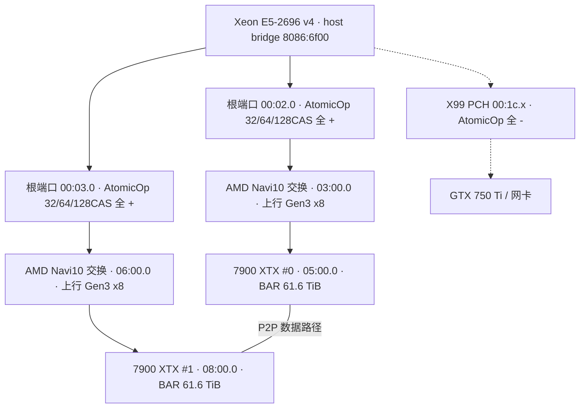
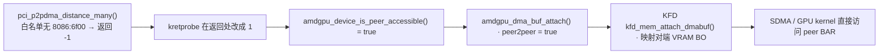
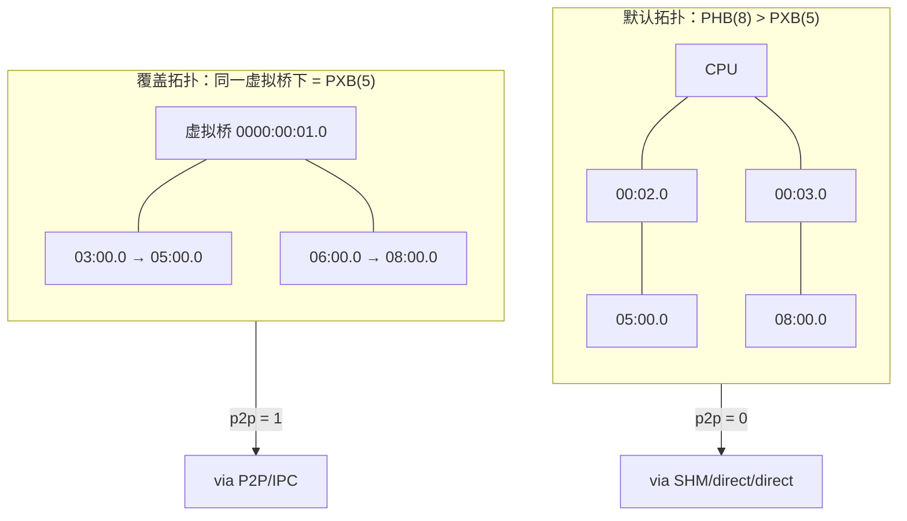

# 在 X99 上打开双 7900 XTX 的 PCIe P2P

> 工程复现报告 · 2026-10-26
>
> 不改内核、不改 `amdgpu.ko`：用一个不到 50 行的 kretprobe 模块绕开 `pci_p2pdma` 的芯片组白名单，再用一份拓扑 XML 骗过 RCCL 的 PHB 策略。下面是完整环境、复刻过程、十八次翻车，以及可以照抄的关键参数。

| 指标 | 结果 |
|---|---|
| 远端写 / 异步 SDMA 单向 | **5.23 GB/s** |
| 双向异步拷贝聚合 | **6.66 GB/s** |
| RCCL busbw | **4.0 → 5.1 GB/s（+27%）** |
| 内核 / 驱动重编译 | **0 次** |
| 持久系统改动 | **1 个 modprobe 配置 + 1 个约 200 KB 模块** |

---

## 结论速览（TL;DR）

- **P2P 真的打开了。** `hipDeviceCanAccessPeer` 两个方向都从 0 变成 1，dmesg 里 `PCIe P2P access is not supported by the chipset` 消失，KFD 出现真实 p2p link（`weight 40 / 8000 MB/s / flags 3`）。
- **关键手段是符号级劫持，不是重编内核。** kretprobe 挂 `pci_p2pdma_distance_many`，把返回值改成 1；持久改动只有一个 `softdep` 配置和一个约 200 KB 的 `.ko`。
- **RCCL 还有第二道门。** Intel x86 上 RCCL 强制 `p2pLevel = PATH_PXB`，本机路径是 PHB(8) → 默认回落 SHM。用 `NCCL_TOPO_FILE` 覆盖成 PXB 后，日志变成 `isAllDirectP2p 1` / `via P2P/IPC`。
- **性能天花板由 Gen3 x8 决定。** 上游交换芯片只有 8 GT/s x8（理论 7.88 GB/s），实测写 5.23 GB/s ≈ 66% 效率；参考平台的 Gen5 x8 是 27–29 GB/s。
- **TP2 端到端只快 1–3%。** 解码每 token 约 54 ms，其中两次 allreduce 合计约 4 ms（~7%），瓶颈在单卡算力，不在卡间通信。
- **最容易误判的一点：** 同步 `hipMemcpy` 只有 2.5 GB/s，不代表 SDMA 走了主机中转；`AMD_LOG_LEVEL=4` 证明它是直达 peer BAR，慢在 API 与方向不对称。

---

## 目录

1. [本机环境](#1-本机环境一台典型的-x99-双卡工作站)
2. [两篇参考贴](#2-两篇参考贴一篇排除法一篇给钥匙)
3. [复刻路线与原理](#3-复刻路线从重编内核转向符号级劫持)
4. [翻车全记录](#4-翻车全记录十八次踩坑)
5. [成功关键参数清单](#5-成功关键参数清单可以照抄的部分)
6. [性能实测](#6-性能实测523-gbs-的天花板与-66-的效率)
7. [限制与适用边界](#7-限制与适用边界)
8. [复现步骤与回滚](#8-复现步骤与回滚)
9. [附录](#9-附录文件清单与术语)

---

## 1. 本机环境：一台典型的 X99 双卡工作站

这台机器的定位很明确：上一代服务器平台、单路 22 核、128 GB 内存、两张 7900 XTX 做本地推理。它不在 AMD 的 P2P 支持矩阵里，但硬件通路本身并不缺——缺的只是软件层的一道白名单。

| 层级 | 项目 | 本机值 | 备注 |
|---|---|---|---|
| 系统 | 发行版 / 内核 | Ubuntu 24.04.5 LTS / `7.0.0-38-generic` | 原版 HWE 内核，未替换 |
| CPU | 处理器 / 插槽 | Intel Xeon E5-2696 v4 @ 2.20 GHz | Broadwell-EP，1 路，22 逻辑核（HT 关闭） |
| 主板 | Host Bridge | `8086:6f00` | X99 / C610 芯片组，P2P 白名单里没有它 |
| 内存 | 容量 | 125 GiB 可用 | DDR4 ECC，四通道 |
| GPU | 计算卡 ×2 | Radeon RX 7900 XTX，`1002:744c`，gfx1100 | 各 25,753,026,560 B ≈ 23.98 GiB |
| GPU | 亮机卡 | GeForce GTX 750 Ti，`10de:1380` | nvidia 专有驱动，接显示器 |
| PCIe | GPU 链路 | 16 GT/s ×16（Gen4 ×16） | 两张卡各自跑到满宽 |
| PCIe | 上行瓶颈 | 8 GT/s ×8（Gen3 ×8） | **单方向理论 7.88 GB/s，全报告的性能天花板** |
| PCIe | 交换芯片 | AMD Navi 10 XL，`1002:1478` / `1479` | 03:00.0 / 04:00.0 与 06:00.0 / 07:00.0 |
| IOMMU | 模式 | VT-d Translated，60 个 domain | **不是 passthrough；高位 BAR 能被翻译靠它** |
| BAR | 显存映射基址 | `0x3820_0000_0000` / `0x3830_0000_0000` | ≈ 61.6 TiB，远高于 44 位 DMA 掩码 |
| DMA | GPU 掩码 | 44 bit | amdgpu 默认值，未抬高 |
| 软件 | ROCm | 7.2.0 | `/dev/kfd`、renderD128 / renderD129 正常 |
| 软件 | RCCL | 2.27.7 | 不是参考贴里的 2.30.4 |

### PCIe 拓扑



图 1：本机 PCIe 拓扑。两张计算卡各挂一个根端口，中间各经过一颗 AMD Navi 10 XL 交换芯片；PCH 只接亮机卡和网卡。

> **为什么这个拓扑很关键**
>
> 两块 GPU **都不在 PCH 下**，而是各自直连 CPU 根端口。因此 #2525 里那条「PCH 端口 AtomicOp Completer 全 `-` → 原子写失败」的故障链，在本机**根本走不到**。真正拦路的是另一个东西：`pci_p2pdma` 的芯片组白名单。

### 改造前的基线

原版内核、未做任何修改时，两张卡之间没有任何直连语义，所有跨卡拷贝都被运行时拆成「写回主机内存 + 从主机内存读回」。

| 指标 | 结果 | 说明 |
|---|---|---|
| `hipDeviceCanAccessPeer(0→1 / 1→0)` | **0 / 0** | 无法 `hipDeviceEnablePeerAccess` |
| dmesg 关键行 | — | `PCIe P2P access is not supported by the chipset` |
| 单向跨卡拷贝（512 MB） | 2.75 GB/s | 16 / 128 / 512 MB 均稳定在 2.71–2.76 |
| 双向同时拷贝 | 2.72 GB/s 合计 | 每个方向约 1.36 GB/s |
| RCCL allreduce（128 MB） | 4.01 GB/s | P2P 关闭，走 SHM |
| 可纠正 AER（启动 3 分钟内） | 315 / 384 条 | 只在通往 GPU1 的 00:03.0 → 06:00.0 路径；GPU0 路径 0 条 |

---

## 2. 两篇参考贴：一篇排除法，一篇给钥匙

整个方案不是从零设计出来的，而是把两篇帖子的结论拼起来：先用 #2525 排除「PCH 原子写」这条故障链，再用 #2599 找到真正的门槛。（`#2525` / `#2599` 是 lcz.me 论坛的帖子编号，原文链接见文末附录。）

### 2.1 #2525：PCH 平台的坑，本机不适用

这篇帖子的核心是：PCH 端口的 AtomicOp Completer 能力为全 `-`，amdgpu 因此禁用 atomics，RCCL 的 hidden hostcall 门铃（PCIe 原子写）失败，最终抛 `hipErrorInvalidState(401)`。按它的五条判据逐条实测：

| #2525 判据 | 本机实测证据 | 是否成立 |
|---|---|---|
| RCCL kernel 被 device-link 挂 hidden hostcall buffer，门铃 = PCIe 原子写 | CLR 中确实存在 `hidden_hostcall_buffer` 字符串（ROCm 7.2.0 与 torch 自带 6.4 版本都有）；但本机 RCCL 是 2.27.7 | 机制存在 |
| 失败卡跟着 PCH 端口走（AtomicOp Completer 全 `-`） | PCH 端口 `00:1c.0 / 1c.2 / 1c.3` 确为 `Routing- 32bit- 64bit- 128bitCAS-`，与贴中一致；但两块 7900 XTX 都不在 PCH 下 | **现象不适用** |
| 两块 GPU 的上游根端口 / 交换芯片能力 | 根端口 `00:02.0 / 00:03.0` 均 `AtomicOpsCap: 32bit+ 64bit+ 128bitCAS+`；交换芯片 `03/06:00.0` 为 `Routing+`；GPU 自身 `AtomicOpsCtl: ReqEn+` | **原子写通路完整** |
| amdgpu 因缺 atomics 禁用，HIP 直接拒发 kernel（401） | dmesg 无任何 atomics 禁用记录，只有 `PCIe P2P access ... not supported by the chipset`；TP2 从未出现 401 | **不触发** |
| 必须自编 CLR + `HIP_HOSTCALL_ALLOW_MISSING=1` | stock CLR 中检索不到该环境变量字符串（设了也无效）；但本机 hostcall 本来就能建 | **不需要** |

功能验证也支持这个判断：两张卡各自对 host 映射内存做 64 bit `atomicAdd` 都返回 1；cookie-printf 内核在两块卡上均正常输出，全部 `hipSuccess`。在 `NCCL_P2P_DISABLE=1` 下跑 128 MB ×100 allreduce，algbw / busbw 为 **4.01 GB/s**，预热全部通过。

> **阶段结论**
>
> #2525 描述的 **401 故障链在本机不成立**。不需要自编 CLR，不需要 bind-mount `libamdhip64.so`，也不需要那个只在补丁版 CLR 里存在的环境变量。这省掉了整整一层高风险工作。

### 2.2 #2599：真正的门槛只有一道白名单

参考平台是 Intel Arrow Lake-S + 双 Radeon AI PRO R9700，走的是 Gen5 x8。帖子的关键发现是：amdgpu 判断对端显存可不可达，只看 `pci_p2pdma_distance()` 的返回值；而该函数会在芯片组不在 `pci_p2pdma_whitelist` 时直接返回负数。参考机用 DKMS 给 amdgpu 加了一个 `amdgpu_p2p_force` 模块参数，跳过这道判断。

本机的 `8086:6f00` 同样不在白名单里，`cpu_supports_p2pdma()` 也是 false。所以**门槛完全一致**。差异只在物理带宽：

| 对比项 | 参考贴（#2599） | 本机 |
|---|---|---|
| CPU / 芯片组 | Intel Arrow Lake-S（较新） | Xeon E5-2696 v4 / X99（Broadwell-EP） |
| PCIe 代数 | Gen5 x8（单侧理论 ~31.5 GB/s） | Gen3 x8（单侧理论 7.88 GB/s） |
| BAR 位置 | 61 TiB 高位，靠 VT-d Translated | 同样 61.6 TiB 高位，同样 Translated |
| 门槛 | p2pdma 白名单 | p2pdma 白名单（相同） |
| 实测带宽 | 27–29 GB/s | 5.23 GB/s（写）/ 3.25 GB/s（读） |

> **选路结论**
>
> #2525 用来**排除错误方向**，#2599 用来**提供正确钥匙**。本机不需要处理 atomics 与 401，只需要回答一个问题：怎样在不重编 `amdgpu.ko` 的前提下，让 `pci_p2pdma_distance_many` 返回一个非负值。

---

## 3. 复刻路线：从「重编内核」转向「符号级劫持」

### 3.1 为什么放弃重编内核

最初的计划是照参考项目改内核：在 `pci_p2pdma_whitelist` 里加上 `8086:6f00`，打开 `CONFIG_HSA_AMD_P2P`，再抬高 DMA 掩码。两次编译都失败在「能不能进系统」这一步，细节放在第四章。真正让我改变路线的是成本对比：

| 路线 | 成本与失败模式 |
|---|---|
| 重编内核 | 1.9 GB 模块、455 MB initrd、108 MB `amdgpu.ko`；一次失败就要救援模式；每次内核升级都要重来 |
| 符号劫持 | 一个约 200 KB 模块，不到 50 行 C；不碰内核镜像、不碰 initrd、不碰 GRUB；卸载即回滚 |

而且两者在语义上**完全等价**：amdgpu 并不关心距离具体是几，只关心它是不是负数。参考贴的 `p2p_force` 参数本质也是跳过同一个判断。

### 3.2 不到 50 行代码：把距离改成 1

`pci_p2pdma_distance_many()` 是内核导出的符号，可以用 kretprobe 在它返回时改写寄存器里的返回值。模块只挂这一个符号，因此影响面被限制在调用它的驱动（本机就是 amdgpu）。

```c
// p2p_force.c — 绕过 X99/Broadwell-EP 的 pci_p2pdma 芯片组白名单
// amdgpu 只通过 pci_p2pdma_distance_many() 的返回值判断对端可不可达，
// 这里用 kretprobe 把该调用强制返回正值（距离 = 1）。
#include <linux/kernel.h>
#include <linux/module.h>
#include <linux/kprobes.h>

static int ret_handler(struct kretprobe_instance *ri, struct pt_regs *regs)
{
    regs_set_return_value(regs, 1);   // 强制“距离 = 1”，即同一 P2P 域
    return 0;
}

static struct kretprobe p2p_krp = {
    .kp.symbol_name = "pci_p2pdma_distance_many",
    .handler        = ret_handler,
    .maxactive      = 32,
};

static int __init p2p_force_init(void)
{
    int ret = register_kretprobe(&p2p_krp);
    if (ret)
        pr_err("p2p_force: register_kretprobe failed %d\n", ret);
    else
        pr_info("p2p_force: hooked, force return 1\n");
    return ret;
}

static void __exit p2p_force_exit(void)
{
    unregister_kretprobe(&p2p_krp);
}

module_init(p2p_force_init);
module_exit(p2p_force_exit);
MODULE_LICENSE("GPL");
MODULE_DESCRIPTION("Force pci_p2pdma_distance_many to report peer distance (X99 P2P)");
```

仓库里随附的 [`../kernel/p2p_force.c`](../kernel/p2p_force.c) 是上面这版的加固形态：entry handler 先看 `provider->vendor`，只有 AMD 显卡（`PCI_VENDOR_ID_ATI`）的查询才改成 1，其余放行真实返回值。因为该符号在内核树里还有 `xe` / `habanalabs` / `nvmet` 三个导入者，机器上又插着一张 NVIDIA 亮机卡，不加这个条件就会把非 P2P 设备当成可达对端。

构建和安装同样只有三步：

```bash
# 1) 编译（需要当前内核的 headers）
make -C /lib/modules/$(uname -r)/build M=$PWD modules

# 2) 安装到当前内核的 extra 目录
sudo cp p2p_force.ko /lib/modules/$(uname -r)/extra/
sudo depmod -a

# 3) 保证 amdgpu probe 之前 kprobe 已就位
echo 'softdep amdgpu pre: p2p_force' | sudo tee /etc/modprobe.d/p2p-force.conf
```

Makefile 只需要一行 `obj-m += p2p_force.o`。安装完重启，`p2p_force` 会在开机约 5.8 秒时先于 amdgpu 加载。这一步的顺序不能错：如果 amdgpu 已经 probe 完，再加载模块就来不及了。

### 3.3 它为什么能一路改变 SDMA 的行为

这个返回值不是只影响一行日志，而是贯穿了 amdgpu 与 KFD 的三层判断。理解这条链路，才能明白为什么「只改一个函数」就能让 SDMA 和 GPU kernel 都开始直连对端显存。



图 2：一个返回值的因果链。若距离为负，`peer2peer` 会被置为 false，dma-buf 退回系统内存，跨卡拷贝重新变成主机中转。

对应的内核位置是 `amdgpu_device.c` 的 `amdgpu_device_is_peer_accessible()` 与 `amdgpu_dma_buf.c` 的 `amdgpu_dma_buf_attach()`；KFD 侧则是 `amdgpu_amdkfd_gpuvm.c` 里的 `kfd_mem_attach_dmabuf()`。三处共用同一个距离判断，所以劫持一次，三处同时放行。

### 3.4 生效证据

| 检查项 | 改造前 | 改造后 |
|---|---|---|
| `hipDeviceCanAccessPeer` | 0 / 0 | **1 / 1** |
| dmesg 芯片组告警 | 每次都打印 `not supported by the chipset` | 消失 |
| KFD p2p link | `p2p_links_count = 0` | `count = 1`，`type 2`（PCIe），`weight 40`，`max_bandwidth 8000`，`flags 3` |
| DMA / AER 错误 | — | 压测全程 0 条 DMAR / 0 条新增 AER |
| 逐字节校验 | — | 双向 64 M float `bad = 0`；30 轮 256 MB soak 全对 |

### 3.5 第二道门：RCCL 的 PHB 策略

内核把 P2P 打开后，`hipMemcpy` 和自写 kernel 已经能直连，但 RCCL 仍然打印 `via SHM/direct/direct`。原因不是硬件，而是 RCCL 自己的一条平台规则。

在 RCCL 2.27.7 的 `ncclTopoCheckP2p()` 里，对 Intel x86 平台会把 `p2pLevel` 强制设为 `PATH_PXB`。本机两块卡分属两个根端口，拓扑算出来的路径类型是 **PHB(8)**，比 PXB(5) 更「远」，于是判定不可直连。这也解释了为什么手动设置 `NCCL_P2P_LEVEL=PHB` 或 `SYS` 都没用——用户值随后被这条 Intel 规则覆盖。



图 3：覆盖拓扑只改变 RCCL 的路径分类，不改任何硬件或系统设置。两块卡的上行交换芯片被挂到同一个虚拟 PCI 桥下，路径就从 PHB 变成 PXB。

具体做法是给 RCCL 一份 `NCCL_TOPO_FILE`。核心是在 `<cpu>` 下插入一个虚拟桥，再把两张卡（连同它们的交换芯片）挂进去：

```xml
<system version="2">
  <cpu host_hash="0xab3b8373478cf719" numaid="0" affinity="3fffff"
       arch="x86_64" vendor="GenuineIntel" familyid="6" modelid="79">
    <pci busid="0000:00:01.0" class="0x060400" vendor="0x8086" device="0x6f02"
         subsystem_vendor="0x0000" subsystem_device="0x0000"
         link_speed="8.0 GT/s PCIe" link_width="8">

      <pci busid="0000:03:00.0" class="0x060400" vendor="0x1002" device="0x1478"
           link_speed="8.0 GT/s PCIe" link_width="8">
        <pci busid="0000:05:00.0" class="0x030000" vendor="0x1002" device="0x744c"
             link_speed="16.0 GT/s PCIe" link_width="16">
          <gpu dev="0" sm="48" gcn="gfx1100" arch="38911" rank="0" gdr="0"/>
        </pci>
      </pci>

      <pci busid="0000:06:00.0" class="0x060400" vendor="0x1002" device="0x1478"
           link_speed="8.0 GT/s PCIe" link_width="8">
        <pci busid="0000:08:00.0" class="0x030000" vendor="0x1002" device="0x744c"
             link_speed="16.0 GT/s PCIe" link_width="16">
          <gpu dev="1" sm="48" gcn="gfx1100" arch="38911" rank="1" gdr="0"/>
        </pci>
      </pci>
    </pci>

    <!-- 原网卡节点保留 -->
    <pci busid="0000:0b:00.0" class="0x020000" vendor="0x10ec" device="0x8168">
      <nic>
        <net name="enp11s0" dev="0" latency="0" speed="1000" port="0"
             guid="0x0" maxconn="65536" gdr="0"/>
      </nic>
    </pci>
    <nic>
      <net name="tailscale0" dev="1" latency="0" speed="10000" port="0"
           guid="0x1" maxconn="65536" gdr="0"/>
    </nic>
  </cpu>
</system>
```

> **仓库里的那份 XML 不完全一样**
>
> 随附的 [`../topo/fake_topo_p2p.xml`](../topo/fake_topo_p2p.xml) 是最终生效的版本：虚拟桥是 `0000:04:00.0`（`1002:1479`），下挂 `0000:05:00.0` 与 `0000:08:00.0`，没有另建 00:01.0 这一层。上面这段保留了原始记录里的另一版写法。两者思路相同——把两块 GPU 归进同一个虚拟桥，路径类型就从 PHB 变成 PXB。换机器时不要手改：直接跑 `bash scripts/gen-topo.sh`，它从本机 KFD 读 BDF、device id 和 gfx 架构重新生成；在这台机器上生成结果与随附文件逐字节一致。

启动时必须满足另一个条件：**一进程一卡**。

```bash
NCCL_TOPO_FILE=~/x99-7900xtx-p2p/topo/fake_topo_p2p.xml \
  torchrun --nproc_per_node=2 torch_allreduce.py
```

> **为什么必须多进程**
>
> 单进程 `ncclCommInitAll` 同时初始化两张卡时，跨卡 IPC 导入会报 `invalid device context (201)`，这是 HIP 同进程跨卡的限制。拆成两个进程后，`hipIpcOpenMemHandle` 正常，RCCL 才会真正建立 `via P2P/IPC` 通道。

> **两道门，互相独立**
>
> 内核 P2P 与 RCCL 拓扑是**两个独立开关**：内核开了但拓扑不覆盖，RCCL 仍走 SHM；拓扑覆盖了但内核没开，RCCL 会尝试 P2P 然后失败。回滚时也可以分别回退，互不影响。

---

## 4. 翻车全记录：十八次踩坑

这一章按阶段列出所有失败。每一条都写清楚「现场长什么样、根因是什么、最后怎么处理」，因为绝大多数坑会在别人复现时原样重演。

### 4.1 内核路线：三次失败，直接改变方案

| 翻车 | 现场 | 根因与处理 |
|---|---|---|
| 自编 `6.8.12-p2p44` 进不了系统 | 模块 1.9 GB，initrd 455 MB，`amdgpu.ko` 108 MB；GRUB 后卡在 `Loading initial ramdisk`，从未进系统 | 编译带 DEBUG_INFO，体积失控；救援模式卸载，放弃该内核 |
| `7.0.0-38-p2p44` 只装了一半 | 只安装了 initrd 与 System.map，`vmlinuz` 缺失；GRUB 项还带 `nomodeset`（会让 amdgpu probe 返回 -22） | 条目指向不存在的内核文件，属于不可用项；清理 GRUB 与残留文件 |
| 高 MMIO 窗口搬移补丁 | 在 `arch/x86/pci/acpi.c` 里搬移高位 MMIO 窗口，能让 44 位掩码下访问 61 TiB BAR | 不在参考项目内，风险高且无验证手段；从源码撤回 |

### 4.2 用户态环境：ABI、依赖、路径

| 翻车 | 现场 | 根因与处理 |
|---|---|---|
| pip 下载 34 kB/s | `pip install` 卡在几十 kB/s，几小时下不完 rocm 轮子 | 官方源慢；切清华镜像后 25 MB/s |
| torch 与 sgl_kernel ABI 不匹配 | torch 2.9.1+rocm6.4 加载预编 `sgl_kernel` 报 `undefined symbol c10::hip::getCurrentHIPStream` | 版本错配；改装 torch 2.13.0+rocm7.2，并用 `setup_rocm.py install` 重编 sgl_kernel |
| 旧 `.so` 遮蔽新编模块 | 重编后仍报同一个符号错误 | `site-packages/sgl_kernel` 里残留旧文件；整目录删除后重装 |
| sglang 两次 exit 137 | 第一次缺 `tvm_ffi`；第二次缺 `ninja` 可执行文件 | 补 `apache-tvm-ffi`；把 venv 的 `bin` 加入 PATH |
| 后台启动的 sglang 被连带杀死 | `nohup` 启动后 shell 一结束，进程消失，日志文件不存在 | 改用后台任务直接跑前台命令并重定向日志 |

### 4.3 系统操作：显存、模块与权限

| 翻车 | 现场 | 根因与处理 |
|---|---|---|
| `p2p_bw` 直接 OOM | 一个常驻显存的服务（下称 background-service）正占着每卡 25.6 GB 显存，测试程序分配失败 | 测试前 `systemctl stop background-service`，测完再 start |
| `modprobe -r amdgpu` 失败 | `Module amdgpu is in use`，无法热重载 | 改为重启让 amdgpu 重新 probe |
| 检查脚本要求 sudo 密码 | `sudo -n` 全部失败，脚本中断 | polkit 允许直接 `systemctl start/stop`，不需要 sudo |
| `pkill -f "sglang.launch_server"` 杀掉了自己的 shell | 命令本身的命令行也包含该模式 | `pkill -f` 会匹配到执行它的 shell；改用 `pgrep` 定向取 PID 再停 |

### 4.4 测试方法：最危险的一类坑

| 翻车 | 现场 | 根因与处理 |
|---|---|---|
| soak 首轮 `bad = 469152` | 跨设备填充与拷贝之间没有同步，校验读到半成品 | 每次跨设备操作后加 `hipDeviceSynchronize()` |
| allreduce 正确性误判 | 原地累加 24 次后值变成 2²⁴，`bad` 恰好等于元素总数 | 另起一个 `ones` 缓冲做单次归约校验，`bad = 0` |
| 单进程跨卡 IPC 报 201 | `hipIpcOpenMemHandle` 在同一进程、两张卡之间失败 | 确认是 HIP 同进程跨卡限制；改用两进程验证成功 |
| `NCCL_P2P_LEVEL=PHB/SYS` 无效 | 设置了环境变量，RCCL 仍打印 `via SHM` | 读 RCCL 源码发现 Intel x86 强制 PXB；改用 `NCCL_TOPO_FILE` |
| 误判「SDMA 仍走主机中转」 | 同步 hipMemcpy 只有 2.5–2.9 GB/s，据此写下错误结论 | `AMD_LOG_LEVEL=4` 证明是单条 HSA Copy 直达 peer BAR；慢在同步 API 与方向不对称，结论已改写 |
| 源码拉取多次空返回 | WebFetch 取 RCCL 文件两次空返回 / 路径错误；ROCR 源码多次取不到 | 先取到 develop 分支文件；ROCR 改用本地 `libhsa-runtime64.so` 字符串与运行时日志实证 |

### 4.5 三次最贵的翻车，以及它们换来的规则

> **教训一 · 自编内核的成本被严重低估**
>
> 失败的代价不是「多编译一次」，而是**机器可能进不去系统**。455 MB initrd 卡在加载阶段时，没有任何用户态工具可用，只能靠救援模式。相比之下，符号劫持的失败模式温和得多：最坏情况是模块加载失败，系统照常启动。

> **教训二 · 环境变量不等于策略**
>
> `NCCL_P2P_LEVEL` 看起来正是为这个场景设计的，但 RCCL 在 Intel 平台上会用一条更晚、优先级更高的规则覆盖它。判断「为什么没生效」时，**读源码比查文档快**，而读源码又比反复试环境变量快。

> **教训三 · 带宽低 ≠ 路径错**
>
> 同步 `hipMemcpy` 的 2.5 GB/s 和无 P2P 时的 2.7 GB/s 太接近，很容易得出「SDMA 没直连」的结论。真正可靠的证据是运行时日志：`AMD_LOG_LEVEL=4` 下只有一条 `HSA Copy`，src/dst 都是设备虚拟地址，且 `forceSDMA=1`。**先用日志证明路径，再用带宽衡量效率。**

---

## 5. 成功关键参数清单：可以照抄的部分

这一章是给复现者用的。下面每一行都是本机实际生效的值；换机器时需要重新核对的是 **BusID、BAR 基址、根端口能力和拓扑路径**，其余大多可以沿用。

> **抄作业前先确认三件事**
>
> ① 两张卡都不在 PCH 下，且根端口 AtomicOp 能力为 `+`；② IOMMU 是 **Translated** 而不是 passthrough；③ 显存 BAR 虽然高于 DMA 掩码，但能被 IOMMU 正常翻译。三条都满足，才值得继续。

### 5.1 一张总表

| 层 | 参数 / 对象 | 本机值 | 作用 |
|---|---|---|---|
| 平台 | Host Bridge | `8086:6f00` | 不在 p2pdma 白名单，是全部问题的起点 |
| 平台 | 上游 PCIe | 8 GT/s ×8（Gen3 ×8） | 单侧理论 7.88 GB/s，决定性能上限 |
| 平台 | 显存 BAR 基址 | `0x3820_0000_0000` / `0x3830_0000_0000` | ≈61.6 TiB；对端 BAR 直填的目标地址 |
| 平台 | IOMMU / DMA 掩码 | VT-d Translated / 44 bit | 高位 BAR 可被翻译，是直连成立的前提 |
| 内核模块 | 劫持符号 | `pci_p2pdma_distance_many` | amdgpu 判断对端可达性的唯一入口 |
| 内核模块 | 返回值 | `1`（非负） | 等效「同一 P2P 域」 |
| 内核模块 | 模块名 / 参数 | `p2p_force` / `maxactive = 32` | 无模块参数，纯符号劫持 |
| 内核模块 | 加载顺序 | `softdep amdgpu pre: p2p_force` | 必须在 amdgpu probe 之前就位 |
| KFD | `p2p_links_count` | `1` | 真实 p2p link 出现的标志 |
| KFD | `type / weight / flags` | `2`（PCIe）/ `40` / `3` | KFD 拓扑对链路的分类 |
| KFD | `max_bandwidth` | `8000 MB/s` | KFD 上报的链路能力 |
| RCCL | 版本 / 进程模型 | 2.27.7 / 一进程一卡 | 单进程跨卡 IPC 会报 201 |
| RCCL | 拓扑覆盖 | `NCCL_TOPO_FILE=topo-pxb.xml` | 把路径从 PHB 改成 PXB |
| RCCL | 虚拟桥 | `0000:00:01.0`，class `0x060400`，vendor `0x8086`，device `0x6f02` | 让两块卡落在同一个 PXB 下 |
| RCCL | GPU 节点 | `dev=0/rank=0`、`dev=1/rank=1` | 与 CUDA/HIP 设备序一致 |
| 运行时 | 测试前状态 | background-service 停止 | 避免 25.6 GB/卡 的显存占用导致 OOM |
| 运行时 | sglang 关键参数 | `--tp-size 2`、`--disable-custom-all-reduce`、`--attention-backend triton`、`--mem-fraction-static 0.85` | 本机缺 `amdsmi`，CustomAllreduce 关闭，走 RCCL |
| 运行时 | 不需要的变量 | `HIP_HOSTCALL_ALLOW_MISSING`、`NCCL_P2P_LEVEL` | 一个 stock CLR 不认，一个会被 Intel 规则覆盖 |

### 5.2 判定「真的成功」的阈值

| 判据 | 成功值 | 失败/未生效值 |
|---|---|---|
| `hipDeviceCanAccessPeer` | **1 / 1** | **0 / 0** |
| dmesg | 无 `not supported by the chipset` | 每次 probe 都打印 |
| KFD `p2p_links_count` | 1 | 0 |
| RCCL 日志 | `isAllDirectP2p 1` / `via P2P/IPC` | `via SHM/direct/direct` |
| 单向带宽（Gen3 ×8） | **≥5 GB/s** | 2.5–2.8 GB/s（主机中转） |
| 参考平台（Gen5 ×8） | 27–29 GB/s | — |

注意：带宽阈值随平台变化。Gen3 ×8 上 5.2 GB/s 已经是 66% 链路效率，不要拿 Gen5 的 27 GB/s 当及格线。

### 5.3 最小可用配置

如果只想复现「能用」的状态，实际需要落地的文件只有三个，外加一条启动命令：

| 文件 | 路径 | 作用 |
|---|---|---|
| `p2p_force.ko` | `/lib/modules/$(uname -r)/extra/p2p_force.ko` | kretprobe 模块 |
| `p2p-force.conf` | `/etc/modprobe.d/p2p-force.conf` | `softdep amdgpu pre: p2p_force` |
| `topo-pxb.xml` | 任意可读路径，运行时用 `NCCL_TOPO_FILE` 指定 | RCCL 路径分类覆盖 |

> 这是手工复刻时的最小集合。仓库里的 `kernel/install-p2p-kernel.sh --dkms` 会自动完成同样的事，并把配置统一成 DKMS 布局（`/lib/modules/$(uname -r)/updates/dkms/p2p_force.ko.zst`）和带序号前缀的 `/etc/modprobe.d/99-p2p-force.conf`；已不再使用 `extra/` 下的裸 `.ko`。

---

## 6. 性能实测：5.23 GB/s 的天花板与 66% 的效率

以下数据全部在 P2P 生效、background-service 停止、显存空闲的状态下测得。单侧 Gen3 ×8 的理论值是 7.88 GB/s，所有数字都应该放在这个上限下读。

> 本章与下一章的原始数据来自内部基准脚本（`p2p_bw` / `p2p_verify` / `p2p_watch` 的采集侧），除观测脚本外**未随本仓库发布**。

| 路径 | 数据量 | 带宽 | 说明 |
|---|---|---|---|
| 远端写（GPU0 kernel 写 GPU1） | 1 GB ×10 | **5.23 GB/s** | 单向最强，约 66% 链路效率 |
| 远端读（GPU0 kernel 读 GPU1） | 1 GB ×10 | 3.25 GB/s | 读方向受 completion 回程影响 |
| gfx push（读远端 + 写本地） | 512 MB ×20 | 2.76 GB/s | 双向合计约 5.5 GB/s |
| gfx pull（GPU1 读 GPU0 + 写本地） | 512 MB ×20 | 2.76 GB/s | 与 push 对称 |
| 双向 `hipMemcpyAsync` | 512 MB ×10 | **3.33 GB/s / 方向** | 合计 **6.66 GB/s**，本次最高聚合 |
| SDMA `hipMemcpy`（同步） | 1 GB ×10 | 2.53–2.94 GB/s | 同步 API 路径偏慢 |
| 8 流并发 SDMA 1→0 | 1 GB ×10 | 1.47 GB/s | 8 条流争用 2 个 SDMA 引擎 |

### 6.1 SDMA 的取证：快慢是两回事

同步 `hipMemcpy` 的数字很容易让人以为 SDMA 没有直连。实际用 `AMD_LOG_LEVEL=4` 抓运行时日志，每次跨卡拷贝只有**一条** HSA Copy，src/dst 都是设备虚拟地址，并带 `forceSDMA=1`：

```text
:4:rocblit.cpp:549 HSA Copy copy_engine=0x1, dst=0x763102000000, src=0x7630dde00000,
   size=536870912, forceSDMA=1, engineType=4, ...
```

如果是主机中转，日志里应该出现 D2H + H2D 两条拷贝，或出现主机地址。实际没有。真正拉开差距的是 API 与方向：

| 调用方式 | 方向 | 带宽 |
|---|---|---|
| `hipMemcpyAsync`（单流） | GPU0 → GPU1（引擎在 GPU1，读 GPU0） | **5.23 GB/s** |
| `hipMemcpyAsync`（单流） | GPU1 → GPU0（引擎在 GPU0，读 GPU1） | 3.39–3.58 GB/s |
| `hipMemcpy`（同步） | 同上两个方向 | 1.45–2.37 GB/s |
| torch `dst.copy_(src)`（异步） | 两个方向 | **5.14–5.15 GB/s** |

方向不对称和内核日志里的 AER 分布一一对应：只有通往 GPU1 的路径（`00:03.0 → 06:00.0 → 08:00`）有 315 / 384 条可纠正 `[12] Timeout`，GPU0 那条路径为 0。写是 posted，不等完成，两个方向都接近 5.2 GB/s；读需要 completion 回程，会被链路重传拖慢。带 `pci=noaer` 启动只是关闭上报，不是修复。

### 6.2 RCCL：从 4.0 到 5.1

| 传输 | Channel | 64 MB | 256 MB | 正确性 |
|---|---|---|---|---|
| 默认（PHB） | `via SHM/direct/direct` | 3.95 GB/s | 4.08–4.27 GB/s | `bad = 0` |
| `NCCL_TOPO_FILE` | `via P2P/IPC` | **5.09 GB/s** | **5.07–5.11 GB/s** | `bad = 0` |

相对无 P2P 基线，RCCL busbw 提升约 **27%**；双向拷贝聚合从约 3.0 GB/s 提升到 6.66 GB/s，约 2.2 倍。这是链路层能看到的最大收益。

### 6.3 TP2 端到端：为什么只快了 1–3%

| 指标 | TP2 / SHM | TP2 / P2P | 变化 |
|---|---|---|---|
| 单流解码 | 18.54 tok/s | 18.71 tok/s | +0.9% |
| 并发 1 / 2 / 4 | 16.78 / 31.66 / 53.04 | 16.94 / 31.88 / 53.69 | +0.7–1.2% |
| 并发 8 | 100.77 tok/s | **103.45 tok/s** | +2.7% |
| 并发 8 的 p50 延迟 | 5.074 s | 4.942 s | −2.6% |
| 2.5K / 4.9K 预填 | 408.9 / 703.4 | 375.5 / 724.4 | 噪声范围 |
| KV 池 | 198410 | 198410 | 不变 |

> **怎么读这个结果**
>
> 每个 token 约 54 ms（18.7 tok/s），其中两次 10 KB 量级的 allreduce 合计约 4 ms，通信只占 **约 7%**。带宽从 4.0 提到 5.1 GB/s，端到端自然只涨 1–3%。要让 P2P 产生明显收益，需要通信占比更高的场景：大 batch allreduce、EP/MoE 的 all-to-all、多卡 cudagraph 融合，而不是单机小模型 TP2 解码。

---

## 7. 限制与适用边界

能用不等于可以无脑用。下面每条都是本机实际观察到的边界，跨平台复现时优先级不同，但都值得先想清楚。

| 边界 | 表现 | 建议 |
|---|---|---|
| PCIe 代数 | 上游交换芯片只有 Gen3 ×8，单侧 7.88 GB/s；实测写 5.23 GB/s（66%），读 3.25 GB/s | 不要用 Gen5 的 27–29 GB/s 当预期；先看 `current_link_speed / width` |
| 方向不对称 | GPU0 读 GPU1 明显慢于反向，与 315 / 384 条可纠正 AER 的分布一致 | 读密集负载优先考虑反向放置；持续监控 `dmesg` 的 AER 计数 |
| 高位 BAR + IOMMU | BAR 在 61.6 TiB，高于 44 位 DMA 掩码；本机靠 VT-d Translated 工作 | 不要关 IOMMU、不要切 passthrough；换平台需重新验证翻译路径 |
| kretprobe 的脆弱性 | 依赖内核符号名与调用约定；内核升级后可能失效 | 升级内核后重跑验证清单；不要把 `.ko` 跨版本复制 |
| RCCL 拓扑覆盖 | BusID、class、vendor/device 都是本机值；换机器必须重写 | 只改路径分类，不改硬件；每台机器维护自己的 XML |
| 单进程限制 | 同进程跨卡 IPC 报 201 | RCCL 必须一进程一卡；训练/推理框架要支持多进程启动 |
| 收益场景 | TP2 解码通信占比 ~7%，端到端只有 1–3% 提升 | 优先用于通信密集场景；不要为了跑分而开 P2P |
| 官方支持 | 绕过白名单属于未支持配置，ROCm 升级可能改变行为 | 把它当实验特性；生产环境保留回滚路径 |

---

## 8. 复现步骤与回滚

下面的顺序按「先备份、再启用、后验证」排列。不要跳过备份：唯一持久改动虽然只有一个 conf 文件，但模块加载顺序出错时，最省事的恢复手段仍然是重启。

### 8.1 备份与基线记录

```bash
# 备份原版 amdgpu 模块与模块列表
mkdir -p ~/p2p-rollback-$(date +%Y%m%d)/module
cp /lib/modules/$(uname -r)/kernel/drivers/gpu/drm/amd/amdgpu/amdgpu.ko.zst \
   ~/p2p-rollback-$(date +%Y%m%d)/module/
lsmod > ~/p2p-rollback-$(date +%Y%m%d)/lsmod.before
sha256sum ~/p2p-rollback-$(date +%Y%m%d)/module/amdgpu.ko.zst

# 记录基线：应当看到 0 / 0 与芯片组告警
dmesg | grep -i "p2p\|atom" | tail -20
```

### 8.2 启用内核侧 P2P

1. 确认内核 headers 与当前内核一致，编译 `p2p_force.ko`。
2. 复制到 `/lib/modules/$(uname -r)/extra/` 并执行 `depmod -a`。
3. 写入 `/etc/modprobe.d/p2p-force.conf`，内容为 `softdep amdgpu pre: p2p_force`。
4. 重启。amdgpu 已在用，`modprobe -r` 不会成功；重启是唯一干净路径。
5. 开机后检查 `lsmod | grep p2p_force`、`dmesg | grep p2p_force`，再做 `canAccessPeer` 验证。

```bash
make -C /lib/modules/$(uname -r)/build M=$PWD modules
sudo cp p2p_force.ko /lib/modules/$(uname -r)/extra/
sudo depmod -a
echo 'softdep amdgpu pre: p2p_force' | sudo tee /etc/modprobe.d/p2p-force.conf
sudo reboot
```

或者直接用仓库里的安装脚本（`--dkms` 会注册 DKMS，内核升级后自动重编）：

```bash
# 不是 05:00.0 / 08:00.0 的机器，先按本机重新生成拓扑
bash ~/x99-7900xtx-p2p/scripts/gen-topo.sh
sudo bash ~/x99-7900xtx-p2p/kernel/install-p2p-kernel.sh --dkms
```

### 8.3 启用 RCCL 侧 P2P

```bash
# 多进程，一进程一卡
NCCL_TOPO_FILE=~/x99-7900xtx-p2p/topo/fake_topo_p2p.xml \
  torchrun --nproc_per_node=2 torch_allreduce.py

# 期望日志
#   isAllDirectP2p 1
#   via P2P/IPC
```

### 8.4 验收清单

| 检查 | 命令 / 位置 | 期望 |
|---|---|---|
| 模块已加载 | `lsmod \| grep p2p_force` | 有输出，且 amdgpu 在其后 |
| hook 生效 | `dmesg \| grep p2p_force` | `已在 pci_p2pdma_distance_many 上挂钩（仅对 AMD 对端生效）` |
| P2P 可达 | `hipDeviceCanAccessPeer` | `1 / 1` |
| KFD 链路 | `/sys/class/kfd/kfd/topology/nodes/*/p2p_links` | `count = 1`，`8000 MB/s` |
| RCCL 路径 | 启动日志 | `isAllDirectP2p 1`、`via P2P/IPC` |
| 正确性 | 逐字节校验 / allreduce | `bad = 0` |
| 稳定性 | `dmesg`、AER 计数 | 无新增 DMAR 错误；AER 不增长 |

### 8.5 回滚

```bash
# 彻底恢复（DKMS 安装版）：注销模块、删配置、重启
sudo dkms remove p2p-force/1.0 --all
sudo rm -f /etc/modprobe.d/99-p2p-force.conf /etc/profile.d/p2p-rccl.sh /etc/p2p/topo-pxb.xml
sudo depmod -a
sudo reboot
```

> **回滚注意**
>
> 只执行 `rmmod p2p_force` **不会**让已经 probe 的 amdgpu 退回无 P2P 状态，因为距离判断在 probe 阶段已经完成。要彻底恢复必须重启。RCCL 侧不需要动系统：不设置 `NCCL_TOPO_FILE` 就恢复默认 SHM 传输。

---

## 9. 附录：文件清单与术语

### 9.1 文件清单

| 文件 | 位置 | 说明 |
|---|---|---|
| `p2p_force.c` | [`../kernel/p2p_force.c`](../kernel/p2p_force.c) | kretprobe 模块源码（AMD 对端过滤版） |
| `Makefile` | [`../kernel/Makefile`](../kernel/Makefile) | `obj-m += p2p_force.o` |
| `install-p2p-kernel.sh` | [`../kernel/install-p2p-kernel.sh`](../kernel/install-p2p-kernel.sh) | 编译 / 安装 / 固化 / 回滚提示 |
| `fake_topo_p2p.xml` | [`../topo/fake_topo_p2p.xml`](../topo/fake_topo_p2p.xml) | RCCL 拓扑覆盖 |
| `p2p_force.ko` | `/lib/modules/$(uname -r)/updates/dkms/`（DKMS 版）或 `extra/`（直装版） | 已安装模块（构建产物，不入库） |
| `p2p_bw.cpp` / `p2p_bw2.cpp` | `~/work/p2ptest/` | push / pull / sdma / bidir、远端读写与多流测试（未随仓库发布） |
| `p2p_verify.cpp` | `~/work/p2ptest/` | 逐字节校验与 soak（未随仓库发布） |
| `RESULTS.md` | `~/work/p2ptest/` | 十一节原始测试记录（未随仓库发布） |
| `README.txt` | `~/p2p-rollback-20261026/module/` | 原版模块备份与回滚说明 |

### 9.2 术语

| 术语 | 说明 |
|---|---|
| P2P | Peer-to-Peer，一张 GPU 直接读写另一张 GPU 的显存，不经过主机内存 |
| p2pdma | 内核的 P2P DMA 框架；`pci_p2pdma_distance_many()` 判断两个设备能否直连 |
| kretprobe | 内核函数返回探针，可在函数返回时修改寄存器返回值 |
| PHB / PXB | RCCL 的拓扑路径类型：PHB 表示跨根端口经主机桥，PXB 表示同一 PCIe 交换域 |
| SDMA | AMD GPU 的复制引擎，可不占用计算单元搬数据 |
| AER | PCIe 高级错误报告；可纠正 Timeout 会拖慢需要 completion 的读操作 |

---

## 来源与参考

1. lcz.me，《TP2 的坑（PCH 平台必看）》——PCH AtomicOp Completer、hidden hostcall 与 401 故障链。  
   <https://lcz.me/topic/2525>
2. lcz.me，双 R9700 / Intel Arrow Lake-S 的 P2P 实现记录——`amdgpu_p2p_force`、p2pdma 白名单与 Gen5 实测带宽。  
   <https://lcz.me/topic/2599>
3. 本机测试记录 `RESULTS.md`（第一至十一节），包含全部原始命令、日志与逐轮数据（内部文件，未随仓库发布）。  
4. Linux 7.0 amdgpu 驱动源码：`amdgpu_device.c`、`amdgpu_dma_buf.c`、`amdgpu_amdkfd_gpuvm.c`（本地只读分析）。  

---

*X99 P2P REPRODUCTION · 2026-10-26 · 数据来自本机实测，未做外推*
